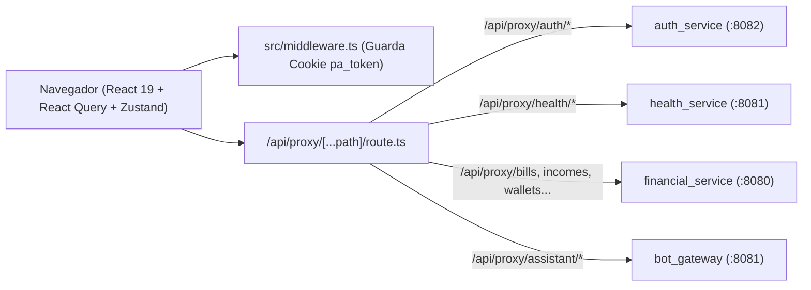

# Documentação Técnica e Guia para IA — `personal-assistant-web`

> **Versão da Documentação**: `1.0.0`
> **Data da Última Atualização**: `2026-10-28`
> **Finalidade**: Documento de referência arquitetural e funcional para revisão, refatoração, correção de bugs e implementação de novas funcionalidades por Agentes de IA e desenvolvedores Frontend/Fullstack.
> **Aplicação**: Aplicação Web Habitus & Aurora Personal Assistant (`personal-assistant-web`)

---

## Histórico de Versões da Documentação

| Versão | Data | Autor | Descrição |
| :--- | :--- | :--- | :--- |
| `1.0.0` | `2026-10-28` | Antigravity AI | Mapeamento integral do código-fonte (Next.js 15 App Router, React 19, TypeScript, Proxy BFF dinâmico, Zustand, TanStack Query v5, React Hook Form + Zod, cálculos fisiológicos e suíte Vitest). |

---

## 1. Visão Geral e Propósito no Ecossistema

O **`personal-assistant-web`** é a interface web moderna e responsiva do ecossistema **Personal Assistant (Habitus)**. Construída com **Next.js 15 (App Router)**, **React 19** e **TypeScript**, ela atua simultaneamente como:
1. **SPA / SSR Frontend**: Dashboard integrado de Saúde, Treinos, Composição Corporal, Gestão Financeira completa e Chat com a IA **Aurora**.
2. **Backend-For-Frontend (BFF Proxy)**: Através da rota dinâmica `src/app/api/proxy/[...path]/route.ts`, roteia todas as chamadas do navegador para os microsserviços de backend (`auth_service`, `financial_service`, `health_service`, `bot_gateway`), eliminando problemas de CORS e centralizando a comunicação em rede local ou Kubernetes.

---

## 2. Stack Tecnológica, Dependências e Variáveis de Ambiente

### 2.1 Stack e Bibliotecas (`package.json`)

| Categoria | Biblioteca / Pacote | Versão | Uso no Projeto |
| :--- | :--- | :--- | :--- |
| **Framework & UI** | Next.js + React + TypeScript | `15.1.0` / `19.0.0` / `5.7.2` | App Router, `output: "standalone"` para Docker |
| **Estilização** | Tailwind CSS + `clsx` + `tailwind-merge` | `3.4.17` | Design System dark-mode (`glass-card`, gradientes emerald/indigo) |
| **Ícones & Gráficos** | `lucide-react` + `recharts` | `^0.468.0` / `^2.15.0` | Iconografia e visualização de dados |
| **Server State** | `@tanstack/react-query` | `^5.62.8` | Cache, invalidação automática e mutações assíncronas |
| **Client State & Auth** | `zustand` + `js-cookie` | `^5.0.2` / `^3.0.5` | Persistência em `localStorage` (`personal-assistant-auth`) + cookie `pa_token` |
| **Formulários & Schemas** | `react-hook-form` + `zod` + `@hookform/resolvers` | `^7.54.2` / `^3.24.1` | Validação tipada de modais de avaliação física, metas, finanças e login |
| **Cliente HTTP & Datas** | `axios` + `date-fns` | `^1.7.9` / `^4.1.0` | Interceptors de autenticação e formatação de datas em `pt-BR` |
| **Testes Unitários** | `vitest` | `^2.1.8` | Testes rápidos de regras de negócio e cálculos científicos |

### 2.2 Variáveis de Ambiente (`.env.example` / `Dockerfile`)

| Variável | Valor Padrão (Fallback Local) | Valor no Cluster K8s (`infra`) |
| :--- | :--- | :--- |
| `PORT` | `3000` | `3000` |
| `AUTH_SERVICE_URL` | `http://localhost:8082` | `http://auth-service.apps.svc.cluster.local:8082` |
| `FINANCIAL_SERVICE_URL` | `http://localhost:8080` | `http://financial-service.apps.svc.cluster.local:8080` |
| `HEALTH_SERVICE_URL` | `http://localhost:8081` | `http://health-service.apps.svc.cluster.local:8081` |
| `BOT_GATEWAY_URL` | `http://localhost:8081` | `http://bot-gateway.apps.svc.cluster.local:8081` |
| `API_BASE_URL` | Opcional (URL unificada de Ingress) | Opcional |

---

## 3. Arquitetura, Proxy BFF e Estrutura de Diretórios



### 3.1 Árvore Completa de Arquivos (`src/`)

```text
c:\Repos\personal-assistant-web\src\
├── middleware.ts                                   # Proteção de rotas autenticadas via cookie 'pa_token'
├── types/
│   └── index.ts                                    # Interfaces TypeScript globais de todos os domínios
├── store/
│   └── use-auth-store.ts                           # Store Zustand (user, token, isAuthenticated, setSession, clearSession)
├── lib/
│   ├── api/
│   │   ├── client.ts                               # Instância Axios (/api/proxy) + interceptors Bearer JWT, X-User-Id e logout 401
│   │   ├── auth.ts                                 # login, register (com fallback mock offline)
│   │   ├── health.ts                               # workouts, body-measurements (CRUD), summary, goals (GET/PUT)
│   │   ├── finance.ts                              # entries, wallets, categories, sub-categories, bills/incomes (CRUD + pay/receive)
│   │   └── assistant.ts                            # morning-briefing, analyze-workout, chat, history (GET/DELETE)
│   ├── hooks/
│   │   ├── use-health.ts                           # Hooks React Query de treinos, avaliações corporais, resumo e metas
│   │   ├── use-finance.ts                          # Hooks React Query de resumo financeiro, criação, edição, exclusão e baixa
│   │   └── use-assistant.ts                        # Hooks React Query de briefing, análise de treino, chat e histórico
│   ├── calculations/
│   │   ├── body-composition.ts                     # Jackson & Pollock 3 dobras, U.S. Navy, Deurenberg, IMC e RCQ
│   │   ├── heart-rate-zones.ts                     # Distribuição em 5 zonas cardíacas (Z1 a Z5)
│   │   ├── trimp.ts                                # Modelo exponencial TRIMP de Banister
│   │   └── calculations.test.ts                    # Suíte de testes unitários Vitest
│   └── utils/
│       └── format.ts                               # Helpers cn, formatCurrency (BRL), formatDate, formatDurationSeconds, getExerciseNamePt
├── app/
│   ├── layout.tsx                                  # Root Layout com QueryProvider e fontes Inter
│   ├── globals.css                                 # Variáveis CSS dark theme e classes utilitárias (.glass-card)
│   ├── api/proxy/[...path]/
│   │   └── route.ts                                # Route Handler Next.js BFF Proxy (GET, POST, PUT, PATCH, DELETE)
│   ├── (auth)/
│   │   ├── login/page.tsx                          # Tela de Login + botão de preenchimento de credencial de teste
│   │   └── register/page.tsx                       # Tela de Cadastro de Usuário
│   └── (dashboard)/
│       ├── layout.tsx                              # Layout autenticado com Sidebar + Topbar
│       ├── page.tsx                                # Dashboard Principal (/)
│       ├── workouts/
│       │   ├── page.tsx                            # Lista de Treinos e métricas agregadas (/workouts)
│       │   └── [id]/page.tsx                       # Detalhes do Treino, Zonas de FC, TRIMP e Análise IA (/workouts/[id])
│       ├── body/
│       │   └── page.tsx                            # Avaliação Corporal, Silhueta, Metas e Histórico CRUD (/body)
│       ├── finance/
│       │   └── page.tsx                            # Gestão Financeira Completa: Carteiras, Filtros e CRUD de Lançamentos (/finance)
│       └── assistant/
│           └── page.tsx                            # Chat Aurora IA com seletor de contexto e histórico persistente (/assistant)
└── components/
    ├── providers/query-provider.tsx
    ├── layout/
    │   ├── sidebar.tsx                             # Navegação lateral responsiva
    │   └── topbar.tsx                              # Barra superior com perfil do usuário e logout
    ├── dashboard/
    │   ├── morning-briefing-card.tsx               # Card do Morning Briefing com prontidão, sono, treino e finanças
    │   └── metric-quick-card.tsx                   # Card compacto de KPIs do Dashboard
    ├── workouts/
    │   ├── workout-card.tsx                        # Card de sessão de treino com badge TRIMP e origem Samsung Health
    │   ├── heart-rate-zones-chart.tsx              # Gráfico horizontal de distribuição nas 5 zonas de FC
    │   └── trimp-badge.tsx                         # Badge colorido de carga fisiológica TRIMP
    ├── body/
    │   ├── body-silhouette-view.tsx                # Visualizador anatômico SVG de circunferências, dobras e alerta de assimetria
    │   ├── measurement-modal.tsx                   # Modal 3 abas (Criar/Editar avaliação) com preview de BF%/IMC em tempo real
    │   └── health-goals-modal.tsx                  # Modal de edição de metas (peso, %BF, passos, sono)
    ├── finance/
    │   ├── financial-summary-cards.tsx             # 4 KPIs financeiros (Saldo Líquido, Receitas, Despesas, Pendências)
    │   ├── entries-table.tsx                       # Tabela de lançamentos com busca textual e filtro por status/tipo
    │   ├── new-entry-modal.tsx                     # Modal de criação de Despesa/Receita (auto-provisiona carteira/categoria padrão)
    │   └── entry-detail-modal.tsx                  # Modal de detalhes, confirmação de pagamento/recebimento, edição e exclusão
    └── assistant/
        ├── chat-window.tsx                         # Interface completa de chat com contexto (ALL, HEALTH, FINANCE) e histórico
        └── markdown-message.tsx                    # Renderizador customizado de Markdown (negrito, listas, blocos)
```

---

## 4. Detalhamento das Páginas e Funcionalidades

### 4.1 Autenticação e Middleware (`middleware.ts` & `use-auth-store.ts`)
- Ao autenticar (`setSession`), o token JWT é salvo tanto no `localStorage` (via middleware `persist` do Zustand) quanto no cookie `pa_token` (7 dias, `sameSite: lax`).
- O `middleware.ts` do Next.js intercepta todas as rotas no servidor:
  - Se o usuário não possui `pa_token` e tenta acessar qualquer rota protegida (`/`, `/workouts`, `/body`, `/finance`, `/assistant`), é redirecionado para `/login`.
  - Se já possui `pa_token` e acessa `/login` ou `/register`, é redirecionado para `/`.
- O interceptor Axios em `src/lib/api/client.ts` injeta `Authorization: Bearer <token>` e `X-User-Id: <username || id>` em todas as requisições para `/api/proxy/*`.

### 4.2 Proxy BFF Dinâmico (`src/app/api/proxy/[...path]/route.ts`)
Mapeia transparentemente os prefixos de rota para os respectivos microsserviços:
- `/api/proxy/auth/*` $\rightarrow$ `${AUTH_SERVICE_URL}/api/auth/*`
- `/api/proxy/health/*` $\rightarrow$ `${HEALTH_SERVICE_URL}/api/health/*`
- `/api/proxy/{financial-entries|bills|incomes|wallets|categories|sub-categories|credit-cards}/*` $\rightarrow$ `${FINANCIAL_SERVICE_URL}/api/*`
- `/api/proxy/assistant/*` $\rightarrow$ `${BOT_GATEWAY_URL}/api/assistant/*`

### 4.3 Módulo de Avaliação Corporal (`/body`)
- **Preview em Tempo Real (`MeasurementModal`)**: Enquanto o usuário digita peso, altura, idade, circunferências ou dobras cutâneas, o modal executa `calculateBodyComposition()` instantaneamente e exibe uma barra de pré-visualização com IMC, % de Gordura, Massa Magra, Massa Gorda e qual protocolo científico está ativo (*Jackson & Pollock 3 Dobras*, *Método da Marinha (U.S. Navy)* ou *Estimativa IMC (Deurenberg)*).
- **CRUD Completo**: Permite criar nova avaliação (`POST`), editar qualquer avaliação do histórico (`PUT /api/health/body-measurements/{id}`) e excluir avaliações (`DELETE /api/health/body-measurements/{id}`).
- **Metas de Saúde (`HealthGoalsModal`)**: Lê e atualiza metas via `GET/PUT /api/health/goals`.

### 4.4 Módulo de Gestão Financeira (`/finance`)
- **Auto-Provisionamento Transparente (`createEntry` em `src/lib/api/finance.ts`)**:
  - Ao criar uma despesa ou receita pela Web, se o usuário ainda não possuir nenhuma carteira ou categoria cadastrada no `financial_service`, o cliente frontend cria automaticamente a carteira `"Carteira Principal"` e a categoria `"Geral"` / subcategoria `"Outros"` antes de postar o lançamento.
- **Ciclo de Vida Completo do Lançamento (`EntryDetailModal`)**:
  - Visualização de detalhes, confirmação de pagamento de conta (`POST /api/bills/{id}/confirmation`) ou recebimento de receita (`POST /api/incomes/{id}/confirmation`), edição de descrição/valor/vencimento (`PUT`) e exclusão (`DELETE`).

### 4.5 Módulo Assistente IA (`/assistant`)
- **Seletor de Contexto**: Permite focar a conversa em `Visão 360° (ALL)`, `Saúde & Treinos (HEALTH)` ou `Finanças (FINANCE)`.
- **Persistência de Histórico**: Carrega o histórico salvo no Redis do `bot_gateway` (`GET /api/assistant/history`) ao abrir a tela e permite limpar a memória recente (`DELETE /api/assistant/history`).

---

## 5. Cobertura de Testes Existente (`Vitest`)

O arquivo `src/lib/calculations/calculations.test.ts` contém **8 testes unitários** validando:
- **`calculateBodyComposition`**:
  - Protocolo Jackson & Pollock (3 dobras cutâneas) para homens.
  - Método da Marinha dos EUA (U.S. Navy) quando não há dobras informadas.
  - Fallback para equação de Deurenberg quando apenas dados básicos (peso, altura, idade, sexo) são fornecidos.
  - Cálculo exato da Relação Cintura-Quadril (RCQ).
- **`calculateHeartRateZones`**:
  - Distribuição correta de amostras e percentuais nas 5 zonas cardíacas (Z1 a Z5) e tratamento de lista vazia.
- **`calculateTrimp`**:
  - Cálculo exponencial de Banister para sessão moderada de 60 minutos e proteção para FC abaixo do repouso (`score = 0`, `level = LIGHT`).

Para executar os testes:
```bash
npm test
```

---

## 6. Diagnóstico Técnico, Limitações Atuais e Guia para IA

### 6.1 Oportunidades de Aprimoramento e Extensão
1. **Gráfico de Linha de 1 Hz na Tela de Detalhes do Treino (`/workouts/[id]`)**:
   - A biblioteca `recharts` já está instalada no `package.json`, mas a página `/workouts/[id]/page.tsx` renderiza atualmente apenas o gráfico de barras horizontais das 5 zonas (`HeartRateZonesChart`). Pode-se adicionar um componente `HeartRateLineChart` usando `ResponsiveContainer` + `AreaChart` do `recharts` para plotar `workout.heartRateSamples` segundo a segundo, igual ao gráfico Canvas do app Android.
2. **Gestão Dedicada de Carteiras, Categorias, Cartões de Crédito e Fluxo de Caixa Preditivo**:
   - O `financial_service` já expõe endpoints para criar/editar/excluir Carteiras (`/api/wallets`), Categorias (`/api/categories`), Cartões de Crédito (`/api/credit-cards`) e Fluxo de Caixa Preditivo (`/api/cash-flow/forecast`), e o Proxy BFF já encaminha essas rotas! Adicionar abas ou modais na página `/finance` para gerenciar Cartões de Crédito, Carteiras e visualizar o gráfico de projeção de fluxo de caixa de 30 dias aproveitará 100% da capacidade já pronta no backend.
3. **Painel de Memórias de Longo Prazo da Aurora (`memory-service`)**:
   - Pode-se adicionar uma rota `/api/proxy/memories/*` apontando para `MEMORY_SERVICE_URL` (`:8000`) e uma aba no `/assistant` permitindo ao usuário visualizar e gerenciar os fatos, hábitos e preferências que a Aurora aprendeu sobre ele.

### 6.2 Diretrizes para Implementação de Novas Features por IA
1. **Sempre Utilize o Proxy BFF (`/api/proxy/*`)**:
   - Nunca faça chamadas `axios`/`fetch` diretamente para `localhost:8080` ou `localhost:8081` a partir de componentes client-side; adicione a função em `src/lib/api/*.ts` usando o `apiClient` (que aponta para `/api/proxy`) e crie o hook correspondente em `src/lib/hooks/use-*.ts`.
2. **Invalidação de Queries no TanStack Query**:
   - Toda mutação (`useMutation`) que alterar dados de saúde ou finanças deve invalidar as query keys relacionadas no `onSuccess` (ex: `queryClient.invalidateQueries({ queryKey: ["finance-summary"] })`).
